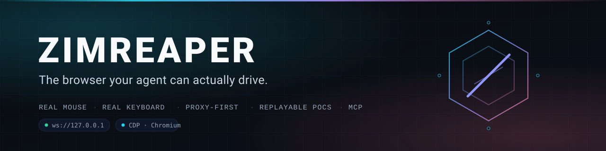
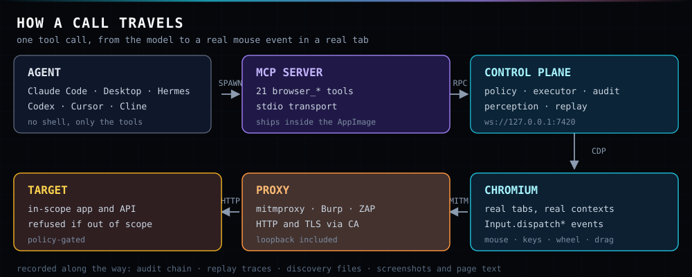

<div align="center">



<br>

**A real Chromium browser that an AI agent drives with a real mouse, a real keyboard and a real wheel — over MCP — built for bug hunting.**

[](https://github.com/Mr-Destroyer/ZIMREAPER/actions/workflows/ci.yml)
[](LICENSE)
[](#build-from-source)
[](#install)
[](#the-21-tools)
[](docs/protocol.md)

[Install](#install) · [Connect an agent](#connect-your-agent) · [Tools](#the-21-tools) · [Bug bounty](#built-for-bug-bounty) · [Trust boundary](#the-trust-boundary) · [Troubleshooting](#troubleshooting)

</div>

---

Most "AI browser" projects call `element.click()` from a script and hope the page believes it. Frameworks check `isTrusted`, bot walls score the event trail, and half the app never notices. ZIMREAPER drives Chromium the way a person does: `Input.dispatchMouseEvent` with real press/release/click counts, real key events with proper codes and modifiers, real wheel deltas, real drag paths. Every click you see in the audit log actually happened in the compositor.

On top of that it gives the agent senses a person does not have: a token-budgeted accessibility snapshot with stable refs, diffs instead of re-reads, a network log of the XHRs the SPA actually made, forked sessions that share one login, and replayable traces that refuse to click when the page drifted.

<br>

## Why the real-input part matters

| Mechanism | DOM automation | ZIMREAPER |
|---|---|---|
| Click path | `element.click()` | `Input.dispatchMouseEvent` — press, release, `buttons`, `clickCount` |
| Framework handlers | often skipped | fire, because the event came from the browser |
| `isTrusted` | `false` | `true` |
| Bot signals | no pointer trail | mouse moves, wheel deltas, key timings |
| Drag & drop | synthesised | real path with intermediate moves |
| What the agent sees | HTML string | AX snapshot + refs + diff + network + screenshot |
| Can a human take over | no | yes — **Take over** button, kill switch on Esc |

<br>

## Architecture



One control plane on `ws://127.0.0.1:7420`, one MCP server with 21 tools, one Chromium. The agent gets tools, not a shell. The human keeps a window, a take-over button and a kill switch.

<br>

## Install

One file, no installer, no root. Build it with `npm run package:linux` (see [Build from source](#build-from-source)), or grab the binary from [Releases](https://github.com/Mr-Destroyer/ZIMREAPER/releases).

```bash
chmod +x ZimReaper-0.1.0-x86_64.AppImage
mv ZimReaper-0.1.0-x86_64.AppImage ~/Applications/

~/Applications/ZimReaper-0.1.0-x86_64.AppImage
```

A browser window opens and a control server starts. First run writes your state directory:

```text
~/.zimreaper/
├── endpoint.json     # {"url":"ws://127.0.0.1:7420","pid":…}  how clients find it
├── control.token     # bearer token, mode 0600
├── policy.json       # what the agent may do, per origin
├── audit/            # hash-chained JSONL, one file per day
└── artifacts/        # screenshots and captured text
```

Check it is alive:

```bash
~/Applications/ZimReaper-0.1.0-x86_64.AppImage info
```

```text
session  s8d373bdbffcf
backend  electron
policy   standard
version  0.1.0 (protocol 0.1.0)

ID  A  TITLE   URL
t1  *  Google  https://www.google.com/
```

Leave the window open while an agent works. That window is the browser the agent is driving — close it and the session ends.

> **No FUSE?** Run `./ZimReaper-0.1.0-x86_64.AppImage --appimage-extract-and-run`.
> **Kernel without user namespaces (containers)?** Add `ZIMREAPER_NO_SANDBOX=1`.

<br>

## Connect your agent

Every client speaks the same MCP server. Point the command at the AppImage with the single argument `mcp`. Add `--launch` when there is no human at the window and the agent should own a headless browser.

| Client | How it connects | Config file |
|---|---|---|
| **Claude Desktop** | stdio MCP server | `~/.config/Claude/claude_desktop_config.json` |
| **Claude Code** | `claude mcp add` | project or user scope |
| **Hermes** | `hermes mcp add` | `~/.hermes/config.yaml` |
| **Codex CLI** | `[mcp_servers]` table | `~/.codex/config.toml` |
| **Cursor** | `mcpServers` JSON | `~/.cursor/mcp.json` |
| **Cline / Continue** | extension MCP settings | per-extension |
| **VS Code** | `servers` JSON | `.vscode/mcp.json` |
| **Anything else** | stdio, `command` = AppImage, `args = ["mcp"]` | — |

<details>
<summary><b>Claude Desktop</b> — JSON</summary>

```json
{
  "mcpServers": {
    "zimreaper": {
      "command": "/home/YOU/Applications/ZimReaper-0.1.0-x86_64.AppImage",
      "args": ["mcp"]
    }
  }
}
```
</details>

<details>
<summary><b>Claude Code</b> — CLI</summary>

```bash
claude mcp add zimreaper -- /home/YOU/Applications/ZimReaper-0.1.0-x86_64.AppImage mcp
```
</details>

<details>
<summary><b>Hermes</b> — CLI</summary>

```bash
hermes mcp add zimreaper \
  --command /home/YOU/Applications/ZimReaper-0.1.0-x86_64.AppImage \
  --args mcp
```
</details>

<details>
<summary><b>Codex CLI</b> — TOML</summary>

```toml
[mcp_servers.zimreaper]
command = "/home/YOU/Applications/ZimReaper-0.1.0-x86_64.AppImage"
args = ["mcp"]
```
</details>

<details>
<summary><b>Cursor</b> — JSON</summary>

```json
{
  "mcpServers": {
    "zimreaper": {
      "command": "/home/YOU/Applications/ZimReaper-0.1.0-x86_64.AppImage",
      "args": ["mcp"]
    }
  }
}
```
</details>

<details>
<summary><b>VS Code</b> — JSON</summary>

```json
{
  "servers": {
    "zimreaper": {
      "type": "stdio",
      "command": "/home/YOU/Applications/ZimReaper-0.1.0-x86_64.AppImage",
      "args": ["mcp"]
    }
  }
}
```
</details>

<details>
<summary><b>No MCP client</b> — raw WebSocket or the built-in agent</summary>

```bash
# drive the browser yourself over the control plane
zimreaper info                              # session, backend, policy, open tabs
zimreaper attach http://127.0.0.1:9222      # wrap an existing Chromium debug endpoint

# or let ZIMREAPER run the loop with your own model
zimreaper run "find the cheapest 27in monitor on this site" \
  --url https://example.com --provider openai --model gpt-4.1
```
</details>

### Tell the agent how to use it

MCP gives the agent tools, not instincts. Paste this into your `CLAUDE.md`, `AGENTS.md` or system prompt — it is the difference between a useful run and 40 wasted snapshots:

```text
You have a real browser through the zimreaper MCP server.
1. browser_snapshot before acting. Refs die with the next snapshot.
2. Prefer browser_diff over re-snapshotting — you only need what changed.
3. Click with a ref. Use browser_extract for tables, not 40 clicks.
4. browser_wait for text or selectors. Never sleep-loop.
5. Do not browser_eval what a click can do honestly.
6. On BLOCKED_BY_POLICY, stop and call browser_ask_human.
7. After two failures on the same element, re-snapshot and rethink.
8. Report the URL and the text you actually verified.
```

The full version, with the failure each rule prevents, is in [docs/agent-prompt.md](docs/agent-prompt.md).

<br>

## The 21 tools

| Group | Tools |
|---|---|
| **Perception** | `browser_snapshot` `browser_diff` `browser_screenshot` `browser_extract` |
| **Input** | `browser_click` `browser_type` `browser_press` `browser_hover` `browser_drag` `browser_scroll` |
| **Navigation** | `browser_navigate` `browser_nav` `browser_tabs` `browser_wait` `browser_set_viewport` |
| **Network & session** | `browser_network` `browser_cookies` `browser_fork_session` |
| **Escape hatches** | `browser_eval` `browser_task` `browser_ask_human` |

<details>
<summary><b>What each one does</b></summary>

| Tool | Behaviour |
|---|---|
| `browser_navigate` | Go to a URL, wait for a lifecycle event, snapshot after |
| `browser_snapshot` | Page as compact ref-tagged text; refs are generation-scoped |
| `browser_diff` | Only refs and text that changed since a snapshot id |
| `browser_screenshot` | PNG of page or clip; `annotate` numbers the interactive elements |
| `browser_extract` | Structured rows from repeating elements: row selector + field selectors |
| `browser_click` | Real mouse click by ref, CSS selector or viewport point |
| `browser_type` | Type into a target, optionally clear first and submit with Enter |
| `browser_press` | Key or chord: `Enter`, `Tab`, `Control+Shift+T` |
| `browser_hover` | Move the real cursor over a target and hold |
| `browser_drag` | Drag with intermediate mouse moves, not a teleport |
| `browser_scroll` | Real wheel deltas on the page or a target |
| `browser_nav` | `back` / `forward` / `reload` |
| `browser_tabs` | `list` / `new` / `close` / `activate` |
| `browser_wait` | Selector, text, URL fragment, network idle, expression, or a ref disappearing |
| `browser_set_viewport` | Resize, optionally with mobile device scale |
| `browser_network` | `log` / `body` / `route` / `replay` — the last two mutate traffic |
| `browser_cookies` | Read, set, clear — for the tab or a URL |
| `browser_fork_session` | Clone the current login into independent tabs |
| `browser_eval` | Evaluate JS in the page (policy-gated, audited) |
| `browser_task` | Run a full autonomous task with the built-in loop (needs a model) |
| `browser_ask_human` | Pause and hand the keyboard to the human |

</details>

<br>

## Built for bug bounty

The browser is where the bug is. ZIMREAPER is shaped around that:

**Proxy-first capture.** Point it at your proxy and everything the browser does — including loopback — goes through it:

```bash
ZIMREAPER_PROXY=http://127.0.0.1:8080 ZIMREAPER_INSECURE=1 \
  ~/Applications/ZimReaper-0.1.0-x86_64.AppImage
```

`--proxy-bypass-list=<-loopback>` is applied for you, because Chromium otherwise silently skips the proxy for `127.0.0.1` — exactly where local API targets live. Verified against mitmproxy for both HTTP and TLS-intercepted HTTPS.

**Scope as code.** Put the program's scope in `~/.zimreaper/policy.json` and out-of-scope hosts are refused before a request leaves the machine:

```json
{
  "mode": "strict",
  "origins": {
    "app.target.com":    { "tier": "transact", "allowUploads": true },
    "api.target.com":    { "tier": "interact" },
    "*.target.com":      { "tier": "read" }
  },
  "maxActionsPerMinute": 120
}
```

**Parallel authz tests from one login.** `browser_fork_session` clones the authenticated state into independent tabs — test the IDOR as user B while user A stays logged in, without re-authenticating.

**Traffic the UI hides.** `browser_network op=log` returns the XHRs, and `op=body` returns the payloads. Money fields, hidden params and client-side trust decisions are visible.

**PoCs that replay.** Record a trace, replay it in a fresh tab, and the player re-binds refs by role, name and ordinal. If the page drifted, it reports a divergence instead of clicking something else:

```bash
zimreaper replay ~/hunts/acme/login.jsonl --url https://app.target.com/login
```

```text
6/6 steps replayed in 1951ms
```

**Evidence that holds up.** Every action is in a hash-chained audit log (`zimreaper audit verify`), screenshots are on disk, and the trace is a file you can attach to the report.

> This is not a scanner. It finds nothing on its own and it will not make you anonymous. It is the browser half of a manual hunt, with an agent doing the boring parts while you watch. Full workflow in [docs/bug-bounty.md](docs/bug-bounty.md).

<br>

## The trust boundary

Three tiers per origin, three global modes, one kill switch.

| Tier | The agent may |
|---|---|
| `read` | navigate, snapshot, extract, screenshot |
| `interact` | click, type, scroll, drag — but not submit payments or delete |
| `transact` | everything, including destructive patterns |

| Mode | Default for unknown origins |
|---|---|
| `strict` | `read` only |
| `standard` | `interact` |
| `permissive` | `transact` |

Exact hosts win over `*.domain` wildcards, and a wildcard covers subdomains but not the apex — so list the apex explicitly. Anything unmatched falls back to the mode default. Destructive actions raise an approval request that surfaces in the HUD. **Take over** pauses the agent and hands you the mouse. **Esc** kills the session immediately. The audit chain is append-only and verifiable:

```bash
zimreaper audit verify
```

```text
audit chain ok (1284 entries) in /home/you/.zimreaper
```

<br>

## Headless and server use

For a box with no monitor — a VPS, a container, a CI job:

```bash
ZIMREAPER_SERVE=1 ZIMREAPER_NO_SANDBOX=1 ~/Applications/ZimReaper-0.1.0-x86_64.AppImage
```

The window exists but is not shown (`opacity 0`, `skipTaskbar`). It has to stay mapped: an unmapped Electron window never acknowledges `Input.dispatchMouseEvent`, so agent clicks would hang until timeout. Agents then attach over the control plane exactly as they do locally.

<br>

## Troubleshooting

<details>
<summary><b>The window opens but nothing connects</b></summary>

```bash
ls -l ~/.zimreaper/            # endpoint.json and control.token should exist
zimreaper info                 # prints the live url, pid and session
```
If the AppImage was started with a custom `ZIMREAPER_HOME`, clients must use the same value.
</details>

<details>
<summary><b>Click times out</b></summary>

Usually a policy refusal or a stale ref. Check the audit tail — a `BLOCKED_BY_POLICY` entry names the origin and the rule. Otherwise the ref is from an older snapshot generation: snapshot again.
</details>

<details>
<summary><b>Agent tools missing in the client</b></summary>

The client caches the tool list at startup. Restart it after editing the MCP config. Then check the server alone:

```bash
ZIMREAPER_HOME=/tmp/zr-check ~/Applications/ZimReaper-0.1.0-x86_64.AppImage mcp --launch
```
It should log a control server on an ephemeral port, then wait for JSON-RPC on stdin.
</details>

<details>
<summary><b>Proxy captures nothing</b></summary>

Chromium bypasses proxies for loopback by default; ZIMREAPER passes `--proxy-bypass-list=<-loopback>` when `ZIMREAPER_PROXY` is set, so check the proxy is actually listening on the interface you gave it. For HTTPS you need the proxy CA trusted, or `ZIMREAPER_INSECURE=1`.
</details>

<details>
<summary><b>AppImage will not start</b></summary>

`dlopen(): error loading libfuse.so.2` → `--appimage-extract-and-run`.
`The SUID sandbox helper binary was found, but is not configured correctly` → `ZIMREAPER_NO_SANDBOX=1`.
</details>

<br>

## Build from source

Node 22+. The AppImage is built by a script that walks the real runtime dependency closure, so no bundler surprises.

```bash
git clone https://github.com/Mr-Destroyer/ZIMREAPER.git
cd ZIMREAPER
npm ci
npm run build            # tsc -b across all packages
npm test                 # 229 tests
npm run package:linux    # → dist/ZimReaper-0.1.0-x86_64.AppImage
```

Verification scripts, each of which proves something specific:

```bash
npm run check:appimage   # CLI, MCP --launch, serve mode, attach — 4/4
node scripts/p0-smoke.mjs         # protocol + control plane + real input — 14/14
node scripts/mcp-check.mjs        # 21 tools over MCP, full login — PASS
node scripts/capabilities-check.mjs  # 6/6
node scripts/replay-check.mjs        # record, replay, divergence — 4/4
```

```text
packages/protocol     frozen wire contract, 40 actions · 14 queries · 20 events
packages/core         CDP backend, executor, control server, discovery
packages/perception   AX snapshot, stable refs, diff, token budget
packages/policy       tiers, approvals, hash-chained audit, vault
packages/replay       trace recorder, ref re-binding player, JSONL
packages/agent        provider-agnostic loop (OpenAI-compatible + Anthropic)
packages/mcp-server   the 21 tools, stdio and HTTP transports
packages/cli          mcp | run | attach | info | audit verify | replay
apps/desktop          Electron shell, tabs, HUD, take-over, kill switch
fixtures/site         the test site every check runs against
```

<br>

## Author

<div align="center">

**Mr-Destroyer** · [github.com/Mr-Destroyer](https://github.com/Mr-Destroyer)
YouTube · [@study_hard69](https://www.youtube.com/@study_hard69)

MIT licensed — see [LICENSE](LICENSE).

<br>

<sub>Built with Electron, Chromium and a healthy disrespect for `element.click()`.</sub>

</div>
